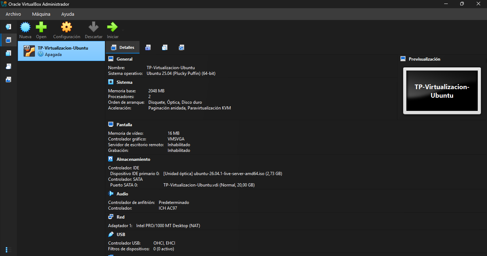
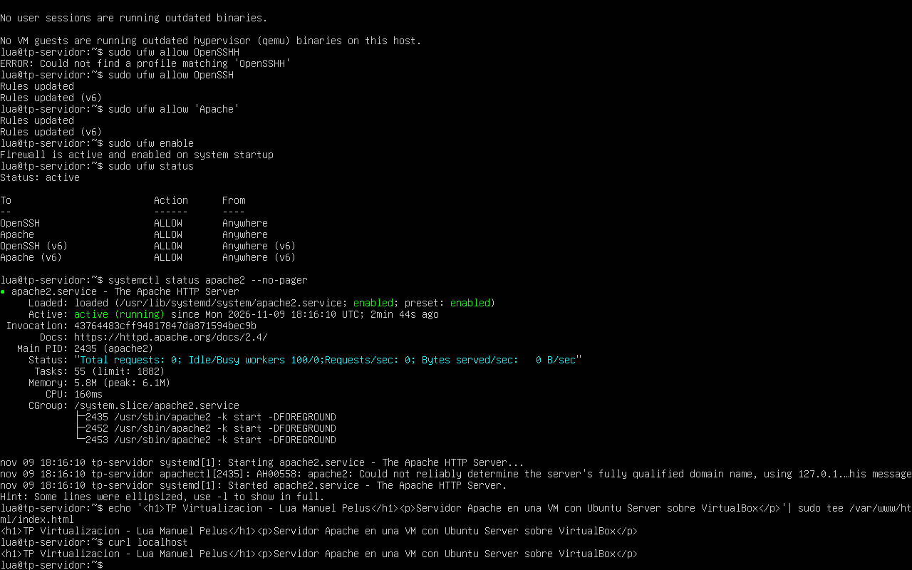
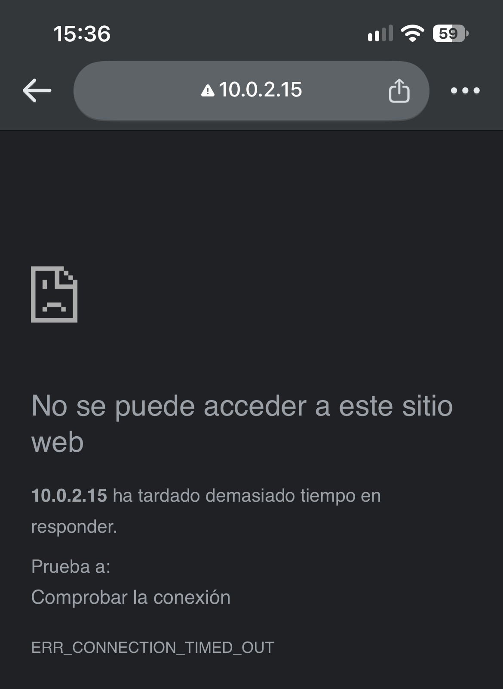
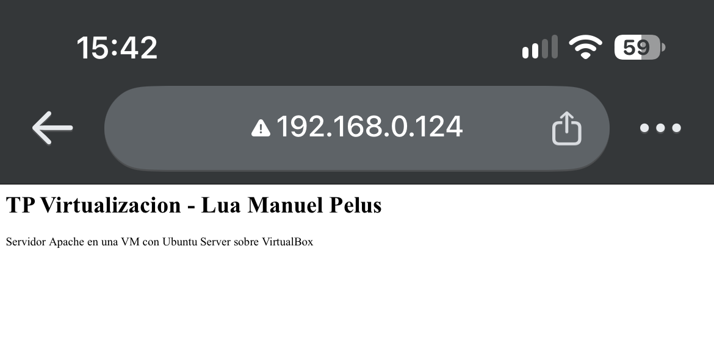
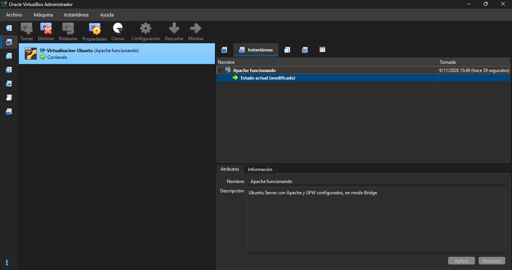
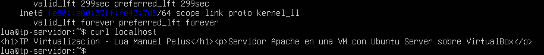

# Virtualización con VirtualBox

**Trabajo Práctico Integrador · Arquitectura y Sistemas Operativos**
Tecnicatura Universitaria en Programación a Distancia – UTN

| | |
| --- | --- |
| Alumno | Lua Manuel Pelus – luampelus@gmail.com |
| Profesor | Martín León Aristiaran |
| Fecha | 09/11/2026 |
| Modalidad | Individual (autorizada por la cátedra) |
| Video explicativo | [completar con el link de YouTube] |
| Informe | [`informe/TP_Integrador_AySO_Pelus_Lua.pdf`](informe/) |

## De qué se trata

El trabajo explica cómo un hipervisor **Tipo 2** (Oracle VirtualBox) virtualiza CPU, memoria, almacenamiento y red. Después lo comprueba en la práctica: se monta un servidor web **Apache** dentro de una máquina virtual con **Ubuntu Server** y se hacen tres pruebas, cada una ligada a un concepto teórico.

## Entorno

| Componente | Detalle |
| --- | --- |
| Anfitrión | Windows 11 · Intel Core i7 7.ª gen (VT-x habilitado) · 12 GB RAM |
| Hipervisor | Oracle VirtualBox 7.2 (Tipo 2) |
| Invitado | Ubuntu Server 26.04.1 LTS |
| Máquina virtual | 2 GB RAM · 2 vCPU · disco dinámico .vdi de 20 GB · red NAT y luego Bridge |
| Servicios | Apache HTTP Server · firewall UFW · OpenSSH |

## Resultados

| Prueba | Qué pasó | Qué demuestra |
| --- | --- | --- |
| Apache | Respondió con la página propia | El hipervisor Tipo 2 ejecuta un servidor completo y aislado |
| Red en NAT | El celular no pudo acceder a 10.0.2.15 | En NAT la red local no puede iniciar conexiones hacia la VM |
| Red en Bridge | El celular abrió la página en 192.168.0.124 | En Bridge la VM es un equipo más de la red, con IP propia |
| Memoria | El proceso figuraba con 87,5 MB, pero al apagar la VM Windows liberó 2,3 GB | La RAM del invitado es RAM real del anfitrión, reservada por el hipervisor |
| Snapshot | Tras borrar Apache, restaurar el snapshot lo devolvió a su estado | Disco base congelado + disco diferencial |

**Dificultad principal:** con Hyper-V activo en Windows 11 (Integridad de memoria), VirtualBox no podía usar VT-x directamente y el kernel de Ubuntu fallaba al arrancar. Se resolvió desactivando Hyper-V.

## Contenido del repositorio

```
TPI-AySO-Virtualizacion/
├── README.md                     ← este archivo
├── informe/                      ← informe técnico en PDF
├── comandos/
│   ├── 01-instalar-apache.sh     ← instalación de Apache y UFW, comentada
│   └── 02-pruebas.md             ← paso a paso de las tres pruebas
└── capturas/                     ← evidencias de cada etapa (01 a 08)
```

## Cómo reproducirlo

1. Habilitar la virtualización (Intel VT-x / AMD-V) en la BIOS/UEFI y, en Windows 11, desactivar la Integridad de memoria e Hyper-V.
2. Instalar [VirtualBox](https://www.virtualbox.org/) y descargar la ISO de [Ubuntu Server LTS](https://ubuntu.com/download/server).
3. Crear la VM (2 GB RAM, 2 CPU, 20 GB .vdi) e instalar Ubuntu Server con OpenSSH.
4. Dentro de la VM, ejecutar [`comandos/01-instalar-apache.sh`](comandos/01-instalar-apache.sh).
5. Seguir [`comandos/02-pruebas.md`](comandos/02-pruebas.md) para las tres pruebas.

## Capturas

| | |
| --- | --- |
|  |  |
| Configuración de la VM en VirtualBox | Firewall, Apache activo y `curl localhost` |
|  |  |
| NAT: el celular no llega a la VM | Bridge: el celular abre la página |
|  |  |
| Snapshot «Apache funcionando» | Apache responde tras restaurar |

Todas las capturas están en la carpeta [`capturas/`](capturas/).
